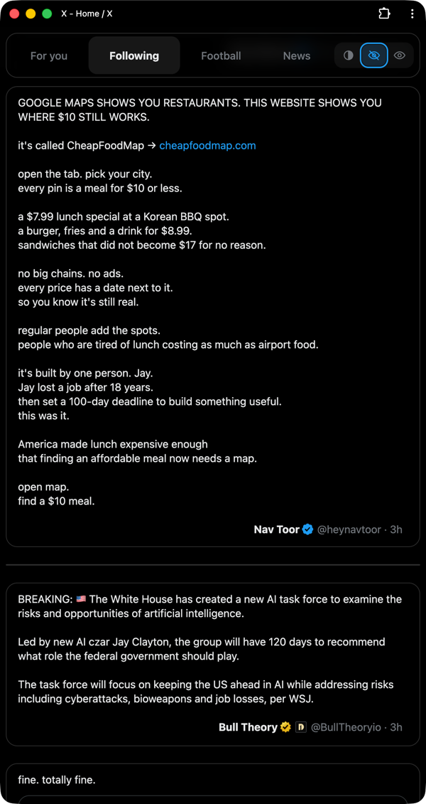
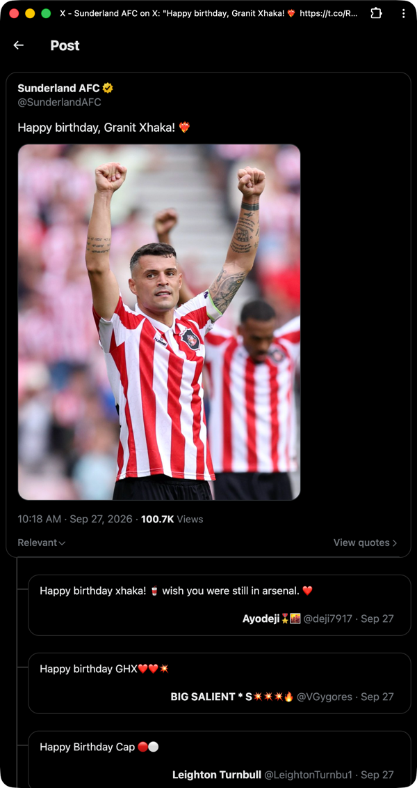
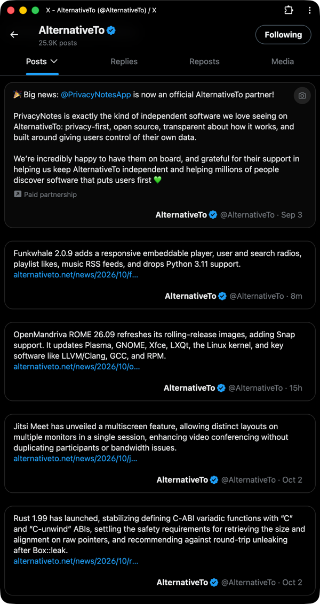

# unread4me

An extension for Chromium-based browsers (Manifest V3) that dims or hides the posts you have already read in the **Following** feed on x.com, and clears away the clutter around them.

A post counts as read once it has dwelled in your viewport long enough (1 second by default) and then scrolled away. Read posts fade back or disappear, so what is new stands out.

It also strips the feed down to what people wrote. Each post is a compact card of plain text, easy to read and quick to scan: no profile pictures, no images or videos, no like, repost and view counts, no buttons, no suggestions and no ads. Nothing pulls your eye away from the words.

When a post is worth more of your time, click it. Its page opens with the full post, its images and videos, and its replies linked underneath, so you get the whole picture only for the posts you choose.

  

## Install

The extension is not in any extension store. Load it from source:

1. Download or clone this repository.
2. Open your browser's extensions page (`vivaldi://extensions` in Vivaldi) and turn on **Developer mode**.
3. Click **Load unpacked** and select the repository folder.
4. Open [x.com/home](https://x.com/home) and switch to the **Following** tab.

It is tested on Vivaldi, and should work in any other Chromium-based browser.

## Read posts

Pick what happens to read posts in the toolbar popup, or with the switch at the right end of the tab bar on Home.

- **Dim.** Read posts fade back. Hovering one brings it back to full strength, which is enough to reread it. Dimming changes opacity and nothing else, so the feed never shifts under you.

- **Hide.** Read posts collapse out of the feed. Only posts below the top of the screen ever collapse, so the post you are reading stays where it is. X's `j` and `k` keys are taken over in this mode so they skip the hidden posts.

- **Show.** Everything shows as X sends it. The read history is kept for when you switch back.

How it decides:

- **Scope.** Only the Following feed. Both Home tabs share the `/home` URL, so the extension reads the selected tab instead. It matches the tab label (configurable in the popup, with a handful of locales built in) and falls back to tab position if the label is unfamiliar. Nothing is dimmed or hidden on For you, profiles, lists, or search.

- **Read.** A post becomes a candidate after it has been at least 60% visible, or has filled half the viewport if it is taller than the screen, continuously for the configured dwell time. It is marked read once it then leaves the screen, so reloading the page does not mark off whatever happened to be showing.

- **Filtered.** A post read in an earlier session is filtered on sight. A post read during *this* session stays at full strength until it leaves the screen. Once filtered it stays filtered, including when you scroll back up and as X recycles the DOM node underneath it.

## Layout tweaks

These apply to every post on x.com, not just the Following feed, and each can be switched in the popup. All are on by default, except the camera button.

- **Hide profile pictures.** The avatar column is removed, so the post takes the full width. In a quoted post only the small avatar next to the name goes.

- **Post first, author below.** The author row moves below the post text, an empty line beneath it, just above the action bar. The post a page is about keeps X's own order.

- **Images and videos only on the post's page.** Photos, videos and link cards are removed from the feed, including those inside a quoted post. Click a post to open its page, and its media shows there. Replies on that page stay without media until you open them in turn.

- **Hide the post and reply boxes.** The "What's happening?" box above the Home timeline is removed, and so is the "Post your reply" box under a post on its own page. Replying from a post's reply button, or with `r`, still opens X's reply dialog.

- **Hide the left navigation bar.** The icon bar down the left edge goes, along with its post button and account menu, and the feed is centred in the window. X's keyboard shortcuts (`g` then `h` for Home, `g` then `n` for notifications, and so on) still get you around.

- **Show long posts in full.** A long post is expanded as soon as it loads, so there is no "Show more" to click.

- **Hide "Who to follow" and "Discover more".** The account suggestions go, both the box in the right sidebar and the module X slips into the timeline, with its heading, accounts and divider. The full list at `/i/connect_people` stays reachable. On a post's page, the "Discover more" section of posts picked from across X goes too.

- **Hide the buttons and menu on posts.** The row of reply, repost, like, views, bookmark and share buttons goes, and so does the "..." menu beside the author name. X's keyboard shortcuts still act on the selected post (`l` to like, `r` to reply, `t` to repost, `b` to bookmark).

- **Show each post as a card.** Every post gets a rounded border of its own, with space around it, instead of a thin line running across the feed. With cards on:

  - The author, handle and date are aligned to the right.
  - The "X reposted" line is dropped, so a repost reads like any other post.
  - The tabs at the top of Home become a card of their own, with the selected tab as a pill and the Dim / Hide / Show switch at the right end.
  - Promoted posts are removed, since an ad blocker hiding one would otherwise leave an empty card behind.
  - On a post's page, the replies are indented under the post, with a line running down from it to each reply.

- **Only the first post of a thread on Home.** A thread shows in the Home timeline as its first post alone. Open that post to read the rest, which shows as its replies. This also applies when X shows a post together with the one it answers: only the post answered is kept.

- **Camera button on cards.** Off by default. A button in the top right corner of each card, shown on hover, copies a picture of the card to the clipboard as a PNG, at most 720 pixels wide. Turning it on asks for the access to all sites described below, and turning it off gives that access back.

## Permissions

- **`storage`** keeps the read history and your settings.

- **Access to x.com and twitter.com** comes with the content scripts, which only run there.

- **Access to all sites (`<all_urls>`)** is optional, and only asked for when you turn the camera button on. Chromium lets an extension take a screenshot of the visible tab only with this access, whatever the site. The scripts still only run on x.com and twitter.com.

## Files

- [`manifest.json`](manifest.json)

  Manifest V3 declaration.

- [`content.js`](content.js)

  Everything that touches the page: feed detection, dwell tracking through an IntersectionObserver, the scan loop that decides which rows to dim or hide, the layout tagging, the tab bar switch and the camera button.

- [`content.css`](content.css)

  The dimming, hiding and layout rules, driven by classes on the root element and data attributes set by `content.js`.

- [`CHANGELOG.md`](CHANGELOG.md)

  What changed in each version.

- [`background.js`](background.js)

  Service worker. It is the sole writer of the read history, so several open x.com tabs cannot clobber each other, and it prunes entries older than 30 days (capped at 20'000 ids). It also takes the screenshot for the camera button, and keeps that switch in step with the optional permission.

- [`popup.html`](popup.html), [`popup.css`](popup.css), [`popup.js`](popup.js)

  Toolbar popup: Dim / Hide / Show, dim strength, dwell time, Following tab label, the layout tweaks, a console logging switch for debugging, counters, and a two-click "Forget everything".

- [`tools/make_icons.py`](tools/make_icons.py)

  Generates the icon PNGs with no image library dependency. The PNGs are committed, so you only need it to change the icon.

## Privacy

Everything stays on your machine, in the browser's local extension storage. Nothing is sent anywhere, and pictures from the camera button only go to your clipboard.

- `readTweets`: a map of post id to the time it was read.
- `settings`: the popup preferences.

## Known limits

- X ships DOM changes regularly. The `data-testid` hooks used here (`cellInnerDiv`, `tweet`, `User-Name` and a few more) have been stable for a long time, but a redesign can break the extension. Symptom: nothing ever fades, or a layout tweak stops applying.

- Reads are only recorded while you are on the Following feed. Seeing a post on For you does not filter it later.

- The camera button can only capture what is on screen, so a post taller than the window is cut off at the bottom.

## Ideas for later

1. Save the read history in smaller pieces, such as IndexedDB or one entry per day, so a save does not rewrite the whole history and send it to every open x.com tab.
2. Define the card spacing once, as CSS variables shared by the cards and the reply line, so the line cannot drift from the cards.
3. Add a per-account allowlist so certain people are never filtered.

## License

[MIT](LICENSE)
